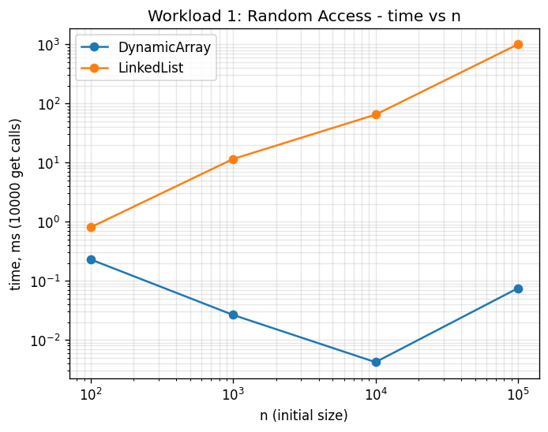
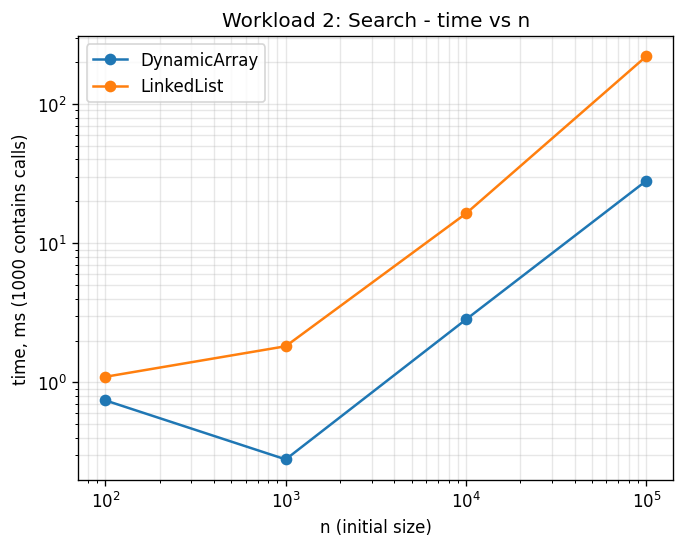
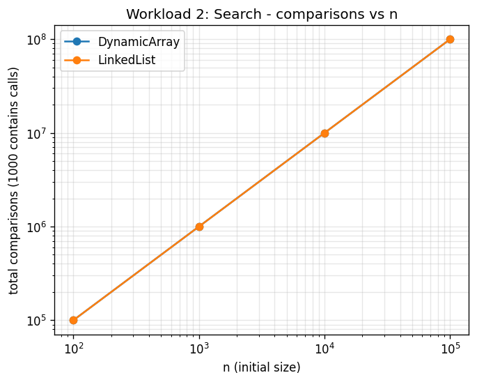
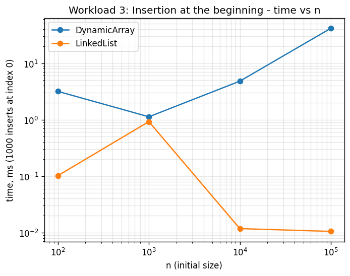
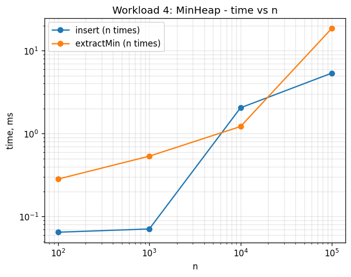

# Assignment 2 — Algorithmic Analysis, Correctness and Performance Trade-offs

Author: student submission for Lecture 3 (Asymptotic Analysis and Algorithmic Correctness).

## 1. Overview

This project implements and analyzes three data structures written from scratch in Java:

- **DynamicArray** — a resizable array (like a mini `ArrayList`) storing `int` values.
- **LinkedList** — a singly linked list with a tail pointer, storing `int` values.
- **MinHeap** — a binary min-heap stored in an array.

All three structures support the operations required by the assignment
(`add`, `add(index, x)`, `remove(index)`, `get(index)`, `contains(x)` for the first
two, `insert`, `peekMin`, `extractMin` for the heap). The goal of the assignment
is not just to implement them, but to:

- prove correctness with loop invariants,
- analyze time/space complexity with O/Ω/Θ notation,
- run controlled benchmarks (4 workloads, n = 100 / 1,000 / 10,000 / 100,000),
- and compare theory with measured results.

### Project structure

```
assignment-2/
├── src/
│   ├── DynamicArray.java
│   ├── LinkedList.java
│   ├── MinHeap.java
│   ├── Benchmark.java
│   └── Tests.java
├── results/
│   ├── tables/         (CSV output of the benchmark)
│   ├── plots/           (PNG plots generated from the CSVs)
│   └── make_plots.py    (small python script, matplotlib)
└── README.md
```

### How to run

```bash
cd src
javac *.java

# run correctness tests
java Tests

# run all 4 benchmark workloads (run from the project root, not from src/)
cd ..
java -cp src Benchmark

# (optional) regenerate the plots
cd results
python3 make_plots.py
```

---

## 2. Complexity Analysis

n = number of elements currently stored.

| Data Structure | Operation      | Best   | Average | Worst  | Aux. space |
|-----------------|----------------|--------|---------|--------|------------|
| Dynamic Array   | `get(i)`       | Θ(1)   | Θ(1)    | Θ(1)   | O(1)       |
| Dynamic Array   | `add(x)`       | Θ(1)   | Θ(1)*   | Θ(n)   | O(1) amortized |
| Dynamic Array   | `add(i, x)`    | Θ(1)   | Θ(n)    | Θ(n)   | O(1)       |
| Dynamic Array   | `remove(i)`    | Θ(1)   | Θ(n)    | Θ(n)   | O(1)       |
| Dynamic Array   | `contains(x)`  | Θ(1)   | Θ(n)    | Θ(n)   | O(1)       |
| Linked List     | `get(i)`       | Θ(1)   | Θ(n)    | Θ(n)   | O(1)       |
| Linked List     | `add(x)`       | Θ(1)   | Θ(1)    | Θ(1)   | O(1)       |
| Linked List     | `add(i, x)`    | Θ(1)   | Θ(n)    | Θ(n)   | O(1)       |
| Linked List     | `remove(i)`    | Θ(1)   | Θ(n)    | Θ(n)   | O(1)       |
| Linked List     | `contains(x)`  | Θ(1)   | Θ(n)    | Θ(n)   | O(1)       |
| Min-Heap        | `insert(x)`    | Θ(1)   | Θ(log n)| Θ(log n)| O(1)      |
| Min-Heap        | `peekMin()`    | Θ(1)   | Θ(1)    | Θ(1)   | O(1)       |
| Min-Heap        | `extractMin()` | Θ(log n)| Θ(log n)| Θ(log n)| O(1)     |

\* `add(x)` on the array is Θ(1) *amortized*: most calls just write into the free
slot, but a resize (doubling the array and copying n elements) happens
occasionally. Averaged over a sequence of n insertions the total cost is
Θ(n), so the amortized cost per call is Θ(1) — this is the classic
"aggregate method" example from the lecture.

### Justification / important differences

- **`get(i)`**: the array stores elements contiguously, so `data[i]` is a
  direct memory access — Θ(1) in every case. The linked list has to start at
  `head` and follow `next` pointers `i` times, so it is Θ(i), which is Θ(n) in
  the worst case (last element) and Θ(1) only in the best case (i = 0).
  **This is the clearest example of two operations that look similar
  ("just get the element at index i") but have very different practical
  cost** — one is a pointer chase, the other is a memory offset.

- **`add(i, x)` / `remove(i)` on the array**: shifting elements to make room
  (or close the gap) touches `n - i` elements. Best case is inserting/removing
  at the end (Θ(1), nothing to shift); worst case is inserting/removing at
  index 0, which shifts everything, Θ(n).

- **`add(i, x)` / `remove(i)` on the linked list**: there is no shifting, but
  we still have to *walk* to position i first (Θ(i)), then the actual
  insert/remove is Θ(1) pointer relinking. Inserting at the head (i = 0) is
  Θ(1) since no walk is needed; inserting near the end is Θ(n).

- **`contains(x)`**: both structures must scan sequentially in the worst case
  (value not present, or present at the last position) → Θ(n) for both. The
  array is faster in practice because of cache locality (contiguous memory),
  even though the asymptotic complexity is identical — this is a good example
  of "same Big-O, different constants".

- **Min-Heap `insert`/`extractMin`**: the heap is a complete binary tree of
  height ⌈log₂(n+1)⌉, stored implicitly in an array. `insert` places the
  element at the end and "sifts up" at most height-many levels → Θ(log n).
  `extractMin` moves the last element to the root and "sifts down" at most
  height-many levels, doing up to 2 comparisons per level → Θ(log n).
  `peekMin` just reads `data[0]` → Θ(1).

---

## 3. Correctness — Loop Invariant Proofs

### Proof 1 — `DynamicArray.add(index, x)` (shifting loop)

```java
for (int i = size; i > index; i--) {
    data[i] = data[i - 1];
}
data[index] = x;
```

**Loop invariant:** *At the start of each iteration, `data[i+1 .. size]`
contains exactly the values that were originally in `data[i .. size-1]`
before the loop started, shifted one position to the right, and
`data[0 .. i]` is untouched.*

1. **Initialization.** Before the first iteration, `i = size`. The range
   `data[i+1 .. size]` is empty, so the claim "it contains the shifted
   original values" is vacuously true. `data[0 .. size-1]` is untouched
   (nothing ran yet). The invariant holds.

2. **Maintenance.** Assume the invariant holds at the start of an iteration
   with some `i > index`. The loop body executes `data[i] = data[i-1]`. Before
   this line, `data[i-1]` still holds its original value (it has not been
   overwritten yet, since the loop only ever writes to indices ≥ the current
   `i`, and `i-1 < i`). After the line runs, `data[i]` now holds the original
   value that was at `data[i-1]`, which is exactly one more shifted element
   added to the already-shifted range `data[i+1 .. size]`. So after the
   assignment the invariant holds for the new range `data[i .. size]`, with
   `i` about to be decremented — i.e. the invariant holds again at the top of
   the next iteration.

3. **Termination.** The loop variable `i` strictly decreases by 1 each
   iteration and the loop stops as soon as `i == index`, so it terminates
   after exactly `size - index` iterations.

4. **Correctness at termination.** When the loop exits, `i == index`, and by
   the invariant `data[index+1 .. size]` holds all the original values that
   were in `data[index .. size-1]`, correctly shifted right by one, and
   `data[0 .. index]` still holds the original values. The line
   `data[index] = x` then places the new element exactly in the freed slot.
   The final array is therefore the original array with `x` inserted at
   position `index` and everything after it shifted right by one — which is
   exactly the postcondition of `add(index, x)`. ∎

### Proof 2 — `MinHeap.extractMin()` (sift-down loop)

```java
int i = 0;
while (true) {
    int left = 2*i+1, right = 2*i+2, smallest = i;
    if (left < size && data[left] < data[smallest]) smallest = left;
    if (right < size && data[right] < data[smallest]) smallest = right;
    if (smallest == i) break;
    swap(i, smallest);
    i = smallest;
}
```
(this runs after the old root is saved, the last element is moved to
`data[0]`, and `size` has already been decremented)

**Loop invariant:** *At the start of each iteration, every node in the tree
except possibly the node at index `i` satisfies the min-heap property
(a node's value is ≤ its children's values), and node `i` is the only node
that might violate it — i.e. the tree would be a valid min-heap if node `i`
were removed from consideration.*

1. **Initialization.** Before the loop, `i = 0`. We just placed the former
   last element at the root, and every other node was left untouched from a
   heap that was valid before extraction. So the only node that can possibly
   violate the heap property is the root, i.e. index `i = 0`. The invariant
   holds trivially at the start.

2. **Maintenance.** Assume the invariant holds for the current `i`: only node
   `i` might be "out of place". The loop finds `smallest`, the index of the
   minimum among `data[i]` and its (at most two) children, using the two
   `if`-comparisons. If `smallest == i`, node `i` is already ≤ both its
   children, so combined with the invariant the whole tree is now a valid
   heap and we break. Otherwise, we swap `data[i]` with `data[smallest]`.
   After the swap, node `i` holds the smallest of the three values compared,
   so it is now ≤ both of its (untouched) children — index `i` is no longer a
   possible violation. The value that used to be misplaced has moved down to
   index `smallest`, whose own children were never touched, so now index
   `smallest` is the *only* node that might still violate the heap property.
   Setting `i = smallest` restores exactly the invariant for the next
   iteration.

3. **Termination.** Each iteration either breaks immediately, or moves `i`
   strictly one level deeper in the tree (`i` becomes `2i+1` or `2i+2`, always
   a greater depth than before). Since the tree has a finite height
   ⌈log₂(size+1)⌉, `i` can move deeper only a bounded number of times before
   reaching a leaf, where both children indices are ≥ `size`, `smallest`
   stays equal to `i`, and the loop breaks. Hence the loop always terminates,
   after O(log n) iterations.

4. **Correctness at termination.** The loop only exits when `smallest == i`,
   which means `data[i] ≤ data[left]` and `data[i] ≤ data[right]` (or the
   children don't exist), i.e. node `i` itself now satisfies the heap
   property. Combined with the invariant ("every node except `i` already
   satisfies the heap property"), this means *every* node satisfies the heap
   property when the loop exits — the array is a valid min-heap again. Since
   the old root was saved before the loop started, `extractMin()` correctly
   returns the previous minimum, and the heap property is restored, which is
   exactly the required postcondition. ∎

---

## 4. Experimental Setup

- **n** (initial size of the structure): 100, 1,000, 10,000, 100,000.
- **m** (number of operations per workload): 10,000 `get` calls (Workload 1),
  1,000 `contains` calls (Workload 2), 1,000 insertions + 1,000 removals
  (Workload 3), n inserts + n extracts (Workload 4).
- Every timed measurement is **repeated 5 times** and the **average** of the
  5 runs is reported.
- Timing is done with `System.nanoTime()`, wrapped tightly around only the
  operation being measured.
- All random data is generated with **`new Random(42)`** (fixed seed), and
  the data is generated **before** the timed section starts (input
  generation and printing are never included in the measured time).
- Simple `static long` counters inside each class count accesses /
  comparisons / element movements, reset right before each timed section.

---

## 5. Results

Full CSV tables are in `results/tables/`. Plots are in `results/plots/`.
Below are the raw numbers actually produced by running `Benchmark.java` on
this machine.

### Workload 1 — Random Access (10,000 `get` calls)

| Structure    | n       | avg time (ms) | accesses | theoretical |
|--------------|---------|----------------|----------|-------------|
| DynamicArray | 100     | 0.23           | 10,000   | Θ(1) each   |
| LinkedList   | 100     | 0.80           | 10,000   | Θ(n) each   |
| DynamicArray | 1,000   | 0.03           | 10,000   | Θ(1) each   |
| LinkedList   | 1,000   | 11.50          | 10,000   | Θ(n) each   |
| DynamicArray | 10,000  | 0.004          | 10,000   | Θ(1) each   |
| LinkedList   | 10,000  | 64.65          | 10,000   | Θ(n) each   |
| DynamicArray | 100,000 | 0.07           | 10,000   | Θ(1) each   |
| LinkedList   | 100,000 | 1,002.38       | 10,000   | Θ(n) each   |



**Analysis.** The `DynamicArray` time stays basically flat (microseconds,
noise-dominated) regardless of n, matching the Θ(1) prediction for `get`. The
`LinkedList` time grows roughly linearly with n (it multiplies by about 10x
each time n multiplies by 10x), matching the Θ(n) prediction, since every
`get(index)` call has to walk from the head. The results agree very clearly
with the theory.

### Workload 2 — Search (1,000 `contains` calls)

| Structure    | n       | avg time (ms) | comparisons | theoretical |
|--------------|---------|----------------|-------------|-------------|
| DynamicArray | 100     | 0.74           | 100,000     | Θ(n) each   |
| LinkedList   | 100     | 1.10           | 100,000     | Θ(n) each   |
| DynamicArray | 1,000   | 0.28           | 1,000,000   | Θ(n) each   |
| LinkedList   | 1,000   | 1.82           | 1,000,000   | Θ(n) each   |
| DynamicArray | 10,000  | 2.84           | 10,000,000  | Θ(n) each   |
| LinkedList   | 10,000  | 16.37          | 10,000,000  | Θ(n) each   |
| DynamicArray | 100,000 | 28.17          | 100,000,000 | Θ(n) each   |
| LinkedList   | 100,000 | 220.94         | 100,000,000 | Θ(n) each   |




**Analysis.** The comparison counts are **identical** between the two
structures for every n (as expected — the algorithm always scans linearly
until it either finds the value or reaches the end, since values are random
and mostly not present). The time, however, is 4–8x higher for `LinkedList`,
because chasing pointers is much slower than reading sequential memory
(cache misses on the linked list vs. cache-friendly access on the array).
This is a textbook case of "same Θ(n), same operation count, different
constant factor because of memory layout".

### Workload 3 — Insertion and Removal (1,000 ops, at begin and at middle)

| Structure    | n       | position | operation | avg time (ms) | movements |
|--------------|---------|----------|-----------|----------------|-----------|
| DynamicArray | 100     | begin    | insert    | 3.17           | 599,500   |
| LinkedList   | 100     | begin    | insert    | 0.10           | 0         |
| DynamicArray | 10,000  | begin    | insert    | 4.81           | 10,499,500|
| LinkedList   | 10,000  | begin    | insert    | 0.01           | 0         |
| DynamicArray | 100,000 | begin    | insert    | 41.59          | 100,499,500|
| LinkedList   | 100,000 | begin    | insert    | 0.01           | 0         |
| DynamicArray | 100,000 | middle   | insert    | 12.92          | 50,499,500|
| LinkedList   | 100,000 | middle   | insert    | 86.04          | 49,999,000|

(full table with removal rows in `results/tables/workload3_insert_remove.csv`)



**Analysis.**
- **Insertion/removal at the beginning:** `LinkedList` is essentially free
  (Θ(1), just re-point `head`) and its time barely changes with n. The
  `DynamicArray` must shift up to n elements every time, so its cost grows
  with n — clearly matching the Θ(n) worst case.
- **Insertion/removal in the middle:** now both structures need Θ(n) work:
  the array still shifts ~n/2 elements, and the linked list must *walk*
  ~n/2 steps to reach the middle before it can relink. For large n the
  linked list is actually *slower* here, because pointer chasing is less
  cache-friendly than shifting a contiguous array.
- This shows nicely how "physical organization" matters: contiguous memory
  (array) is fast for local shifts and costly for shifting the whole buffer;
  linked structure is fast when you already know where to insert (the head)
  and no faster than the array once you have to *find* the position first.

### Workload 4 — Priority Processing (Min-Heap)

| n       | avg insert time (ms) | avg extract time (ms) | avg comparisons | sorted correctly |
|---------|------------------------|--------------------------|-------------------|-------------------|
| 100     | 0.06                   | 0.28                     | 1,069             | true              |
| 1,000   | 0.07                   | 0.53                     | 17,322            | true              |
| 10,000  | 2.05                   | 1.22                     | 239,284           | true              |
| 100,000 | 5.35                   | 18.54                    | 3,059,283         | true              |



**Analysis.**
- `insert` is Θ(log n) per call, so n inserts total Θ(n log n); the measured
  time grows a little faster than linearly, consistent with the log factor.
- `peekMin` is not separately timed (it is trivially Θ(1), just reads index 0)
  but is exercised implicitly and always returns the correct minimum in the
  tests.
- `extractMin` is Θ(log n) per call, n extracts total Θ(n log n); the
  comparison counts grow slightly faster than n, matching n·log₂(n) growth.
- `sorted_correctly = true` for every n confirms extracted elements always
  come out in non-decreasing order, i.e. the heap property is being
  maintained correctly by both `insert` and `extractMin`.

---

## 6. Discussion

1. **How does increasing n affect each workload?** Random access and search
   scale linearly for the linked list and stay flat (get) or linear (search)
   for the array; insertion/removal cost depends heavily on *where* the
   operation happens; heap operations scale as n·log n overall.
2. **Which results agree with theory?** All of them, qualitatively — Θ(1) vs
   Θ(n) for `get`, Θ(n) for `contains` on both structures, Θ(log n) per heap
   operation.
3. **Where do results differ from the prediction?** Only in *constant
   factors*, not in the asymptotic trend — e.g. `LinkedList.contains` and
   `DynamicArray.contains` do the same number of comparisons but the array is
   several times faster in wall-clock time because of cache locality.
4. **Why can two Θ(n) algorithms have different running times?** Big-O/Θ
   notation hides constant factors and lower-order terms. Memory access
   patterns (sequential vs. pointer chasing), CPU cache behavior, and
   per-iteration overhead all affect the constant, even when the number of
   "steps" is identical.
5. **How do constant factors / implementation details affect performance?**
   Contiguous memory access is friendly to CPU caches and prefetching;
   pointer-based structures scatter memory and cause more cache misses. This
   is visible throughout Workload 1, 2 and 3 (middle case).
6. **Why is a Dynamic Array preferable for some workloads?** Whenever random
   access by index or cache-friendly sequential scanning matters (Workload
   1 and 2), and whenever insertions/removals happen mostly at the end.
7. **When is a Linked List useful?** When insertions/removals happen mostly
   at a known position that doesn't require searching (especially the head),
   and no random-access `get(i)` is needed.
8. **Why is a Heap appropriate for priority-based processing?** It gives
   Θ(log n) insert and extract-min instead of Θ(n) (unsorted list) or Θ(n)
   insert (sorted list), and Θ(1) peek — a good balance for workloads that
   repeatedly need "the smallest element right now" while still adding new
   elements.
9. **How does the workload influence the choice of structure?** The right
   choice always depends on the *mix* of operations: an array wins when
   `get`/`contains`/append dominate; a linked list wins when insert/remove
   at the front dominate; a heap wins whenever the workload is
   "repeatedly ask for the minimum while inserting more items".

## 7. Design Recommendations

- Use **DynamicArray** for read-heavy workloads (random access, iteration,
  binary search) and when insertions mostly happen at the end.
- Use **LinkedList** when you frequently insert/remove at the front (or at a
  node you already have a reference to) and rarely need random access by
  index.
- Use **MinHeap** whenever the workload is priority-based: scheduling tasks,
  Dijkstra's algorithm, event simulation, top-k queries — anywhere you
  repeatedly need the minimum (or maximum, with a small flip) while more
  elements keep arriving.

## 8. Conclusion

The experiments confirm the theoretical complexity of all implemented
operations. `DynamicArray.get` is Θ(1) and dramatically outperforms
`LinkedList.get` (Θ(n)) as n grows. Both structures show identical Θ(n)
comparison counts for `contains`, but the array is consistently faster in
wall-clock time due to cache locality — a clear demonstration that Big-O
notation does not capture constant factors. Insertion and removal
performance depends heavily on *where* the operation happens and the
physical layout of the data structure: the linked list wins at the head, the
array is more competitive in the middle. The Min-Heap shows the expected
Θ(log n) behavior per operation and always produces a correctly sorted
extraction order, confirming that the heap invariant is properly maintained
by both `insert` and `extractMin`.
